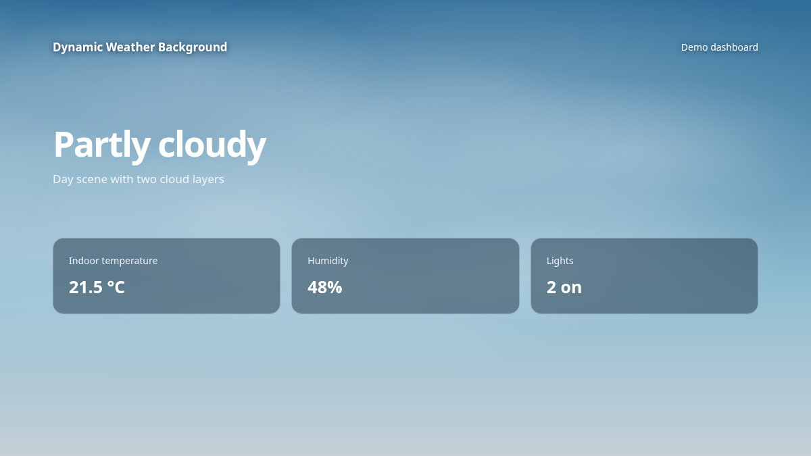
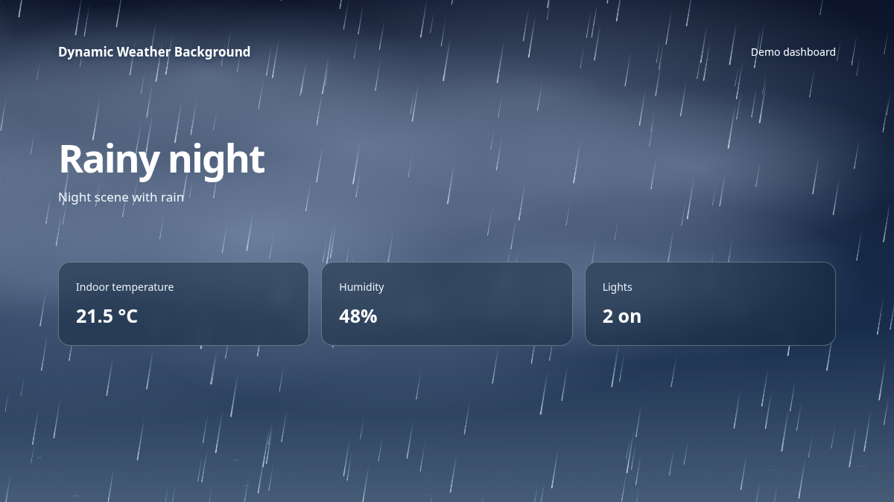

# Dynamic Weather Background

Animated backgrounds for **Home Assistant Lovelace** views based on the current weather, cloud cover, and sun position.

[](https://github.com/elminpl/dynamic-weather-background/releases/latest)
[](LICENSE)

**Source version:** 1.1.0 · **Interface languages:** English and Polish · **License:** MIT · **Dependencies:** none.

[Przejdź do wersji polskiej](#dynamic-weather-background-1)

> Version 1.0.0 is the project baseline, based on a working inline Lovelace resource.

## Features

- Each background applies to the view containing the card.
- Day, night, dawn, and dusk scenes based on `sun.sun`.
- Clouds, rain, snow, hail, fog, and thunderstorms from a `weather.*` entity. The `windy` and `windy-variant` states affect default cloud cover.
- Two animated cloud layers with adjustable speed and opacity.
- Card appearance effects: **none, glass, frosted, soft**.
- Performance modes (**high / balanced / battery**) and animation modes (**auto / reduced / off**).
- Visual editor, temporary weather preview, and live diagnostics.
- The controller card is hidden outside edit mode by default (`hide_card: true`).

## Screenshots

Dynamic Weather Background 1.1.0 running on a demo dashboard with sample data.

| Partly cloudy day | Rainy night |
| --- | --- |
|  |  |

## Install through Marketplace or HACS

1. Open **Marketplace** (**HACS** on older installations) and choose **⋮ → Custom repositories**.
2. Paste `https://github.com/elminpl/dynamic-weather-background`, select **Dashboard** (**Lovelace** or **Plugin** in older HACS versions), and add the repository.
3. Download **Dynamic Weather Background** from the catalog. Reload the browser page if needed.
4. Add **Dynamic Weather Background** to the chosen view through the card picker or YAML editor.
5. Select an existing `weather.*` entity and `sun.sun`.

Use one instance per view. If an inline version is already installed, follow the [migration guide](docs/MIGRATION.md) before adding another resource.

### Manual installation

Download `dynamic-weather-background.js` from **Assets** in the [latest release](https://github.com/elminpl/dynamic-weather-background/releases/latest) and copy it to `/config/www/dynamic-weather-background.js`. Add `/local/dynamic-weather-background.js` to your dashboard resources as a JavaScript module and reload the page. Marketplace and HACS register their own resource.

### Minimal card

```yaml
type: custom:dynamic-weather-background
entity: weather.your_weather
sun_entity: sun.sun
hide_card: true
```

Replace `weather.your_weather` with your Home Assistant entity ID. Other options use their defaults.

## Documentation

- [Configuration reference](docs/CONFIGURATION.md)
- [Migrating from an inline resource](docs/MIGRATION.md)
- [Example configuration](examples/lovelace.yaml)
- [Changelog](CHANGELOG.md)

## Interface language

The card follows the language selected in your Home Assistant profile. English and Polish are supported. Other languages fall back to English. To add a language, add a dictionary to `TRANSLATIONS` in `dist/dynamic-weather-background.js`. Keep the keys and placeholders from the English dictionary. Missing translations fall back to English.

## How it works

The card reads existing Home Assistant entities. Weather update frequency depends on your weather integration. Animation runs locally in the browser. In `auto` mode, the system’s reduced-motion preference disables animation.

## Development and issue reporting

Use [GitHub Issues](https://github.com/elminpl/dynamic-weather-background/issues). Include your Home Assistant and card versions, browser, `animation` and `performance` settings, and a description of the problem. Keep tokens and private instance data out of reports.

## Releases

Add changes to **Unreleased** in both languages in the [changelog](CHANGELOG.md). Run the **Wydanie wtyczki** workflow from `main` after reviewing the changes. Choose `patch` for fixes, `minor` for backwards-compatible features, or `major` for breaking changes. The workflow updates the module and both README version labels, moves the changelog entries under the new version, and publishes a tag and release with the JavaScript file.

## License

MIT. See [LICENSE](LICENSE).

---

# Dynamic Weather Background

Dynamiczne, animowane tło widoku **Home Assistant Lovelace**, reagujące na aktualną pogodę, zachmurzenie i położenie Słońca.

**Wersja źródłowa:** 1.1.0 · **Języki interfejsu:** angielski i polski · **Licencja:** MIT · **Zależności:** brak.

> Wersja 1.0.0 to punkt wyjścia projektu, odtworzony z działającego zasobu Lovelace Home Assistant.

## Możliwości

- Tło przypisane do konkretnego widoku, w którym umieszczono kartę; bez globalnego wpływu na wszystkie pulpity.
- Sceny dnia, nocy, świtu i zmierzchu na podstawie `sun.sun`.
- Reakcja na encję `weather.*`: chmury, deszcz, śnieg, grad, mgła i burze. Stany `windy` i `windy-variant` wpływają na domyślne zachmurzenie.
- Dwuwarstwowe animowane chmury i regulacja ich szybkości oraz widoczności.
- Efekty wyglądu innych kart: **none, glass, frosted, soft**.
- Ustawienia jakości (**high / balanced / battery**) i animacji (**auto / reduced / off**).
- Interaktywny edytor wizualny, symulacja pogody i panel diagnostyczny.
- Domyślnie ukryta karta sterująca (`hide_card: true`), widoczna podczas edycji.

## Zrzuty ekranu

Dynamic Weather Background 1.1.0 na przykładowym pulpicie z danymi demonstracyjnymi.

| Częściowe zachmurzenie w dzień | Deszczowa noc |
| --- | --- |
|  |  |

## Instalacja przez Marketplace / HACS

1. Otwórz **Marketplace** (w starszych instalacjach **HACS**) i wybierz **⋮ → Własne repozytoria** (*Custom repositories*).
2. Wklej `https://github.com/elminpl/dynamic-weather-background`, wybierz kategorię **Dashboard** (w starszym HACS **Lovelace** lub **Plugin**) i dodaj repozytorium.
3. Otwórz **Dynamic Weather Background** w katalogu i pobierz wtyczkę. W razie potrzeby przeładuj stronę przeglądarki.
4. Dodaj nową kartę do wybranego widoku i wybierz **Dynamic Weather Background**, lub użyj edytora YAML.
5. Wskaż istniejącą encję `weather.*` i `sun.sun`.

Nie dodawaj jednocześnie dwóch instancji tej karty w tym samym widoku. Jeżeli w HA masz już starszy zasób inline, zapoznaj się z [instrukcją migracji](docs/MIGRATION.md) **przed** instalacją kolejnej kopii.

### Ręczna instalacja

Pobierz `dynamic-weather-background.js` z sekcji **Assets** w [najnowszym wydaniu](https://github.com/elminpl/dynamic-weather-background/releases/latest) i skopiuj go do `/config/www/dynamic-weather-background.js`. W zasobach dashboardu dodaj moduł JavaScript o URL `/local/dynamic-weather-background.js` i odśwież stronę. **Nie dodawaj podwójnego wpisu zasobu**, jeżeli instalację obsługuje HACS/Marketplace.

### Minimalna karta

```yaml
type: custom:dynamic-weather-background
entity: weather.twoja_pogoda
sun_entity: sun.sun
hide_card: true
```

Zamień `weather.twoja_pogoda` na rzeczywiste `entity_id` z Home Assistant. Pozostałe opcje mają wartości domyślne.

## Dokumentacja

- [Wszystkie parametry](docs/CONFIGURATION.md)
- [Migracja z zasobu inline](docs/MIGRATION.md)
- [Przykład konfiguracji](examples/lovelace.yaml)
- [Historia zmian](CHANGELOG.md)

## Język interfejsu

Wtyczka używa języka ustawionego w profilu Home Assistant. Obsługuje angielski i polski, a dla pozostałych języków wyświetla angielski. Aby dodać kolejny język, dodaj słownik do `TRANSLATIONS` w pliku `dist/dynamic-weather-background.js`, zachowując klucze i parametry z angielskiego słownika. Brakujące tłumaczenia są pobierane z wersji angielskiej.

## Zasady działania

Wtyczka odczytuje istniejące encje Home Assistant — **nie odpytuje zewnętrznego serwisu pogody**. Częstotliwość aktualizacji informacji pogodowych zależy od zainstalowanej integracji pogodowej. Animacja działa lokalnie w przeglądarce. W trybie `auto` systemowa preferencja ograniczenia ruchu wyłącza animację.

## Rozwój i zgłoszenia

Zgłoszenia błędów: [GitHub Issues](https://github.com/elminpl/dynamic-weather-background/issues). Przy zgłoszeniu podaj wersję Home Assistant, wersję wtyczki, przeglądarkę, ustawienia `animation` i `performance` oraz opis problemu. Nie dołączaj tokenów ani prywatnych danych instancji.

## Wydania

Zmiany dopisujemy po angielsku w sekcji **Unreleased** i po polsku w sekcji **Niewydane** w [historii zmian](CHANGELOG.md). Wydanie przygotowujemy po zebraniu i sprawdzeniu zmian. Na GitHubie workflow **Wydanie wtyczki** uruchamia się ręcznie z gałęzi `main`. Wybierz `patch` dla poprawek, `minor` dla zgodnych wstecz nowych funkcji albo `major` dla zmian niezgodnych wstecz. Workflow zwiększa numer w module i obu częściach README, przenosi wpisy do nowej sekcji w changelogu oraz publikuje tag i wydanie z plikiem JavaScript.

## Licencja

MIT — zobacz [LICENSE](LICENSE).
